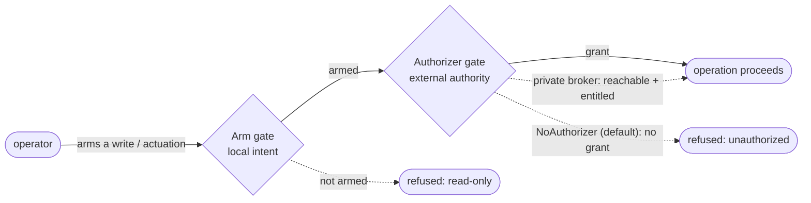
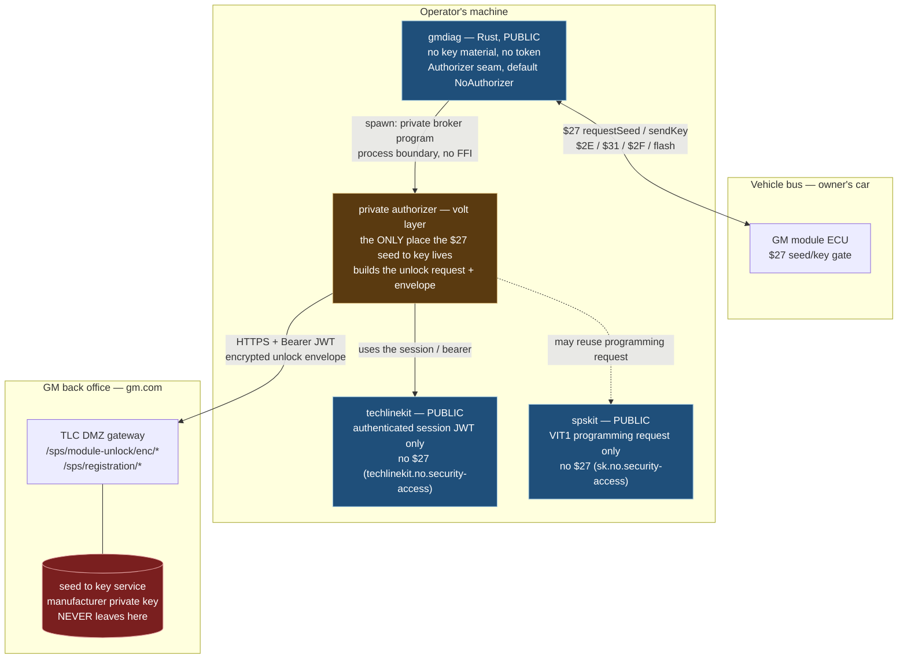
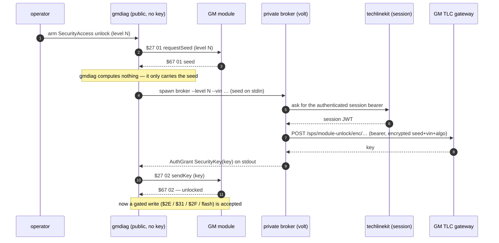
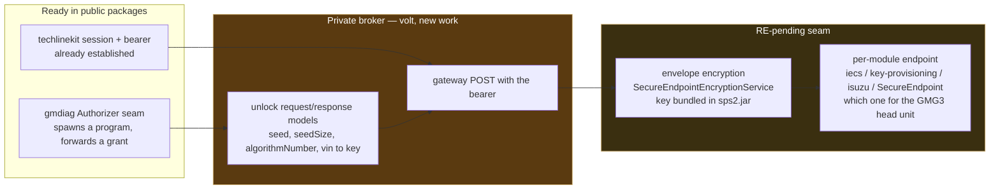

# The SecurityAccess authorization broker

How gmdiag could obtain a SecurityAccess key — and a programming entitlement — from the operator's
own authenticated Techline Connect subscription, **without ever deriving a key or holding key
material**. This documents the `Authorizer` seam (`src/authorizer.rs`) and the one legitimate shape
that can fill it.

> **Placement is an owner decision — the broker is NOT in any public package.** The seed→key broker
> is SecurityAccess (`$27`). Three published packages deliberately exclude it, each as an *owner
> decision* pointing at the same private-research boundary:
>
> - `techlinekit` — `techlinekit.no.security-access`: "`$27` and `$34` through `$37` stay out."
> - `spskit` — `sk.no.security-access` ("same boundary as the volt research notes") and
>   `sk.no.vehicle` ("do not program a controller, calculate a seed or key…").
> - `gmdiag` — ships `NoAuthorizer` by default and holds no key material (`docs/security-access.md`).
>
> So the live broker, if it is built at all, belongs in the **private volt layer**, behind gmdiag's
> `Authorizer` seam — never in techlinekit, spskit, or gmdiag's default build. techlinekit supplies
> only the authenticated *session*; spskit supplies only the *programming request*; the `$27` broker
> is a private authorizer that consumes the session. This is a capability and ToS decision for the
> owner (see §6), not something any public package adopts on its own.

---

## 1. The problem it solves

A GM module gates its writes behind SecurityAccess (`$27`): read a seed, return the matching key,
and only then will it accept a coding write (`$2E`/`$4E`), a routine (`$31`), an I/O control
(`$2F`), or a flash. ISO 14229-1:2013 §9.4.1 is explicit that the client "sends the 'Key'
(appropriate for the Seed received)" — but the function that turns a seed into that key lives in the
manufacturer's back office, not on the module and not in gmdiag.

The firmware survey confirmed the on-vehicle side holds only public material (`volt/docs/
CLOSING-THE-KEY-GAP.md`): the key cannot be computed from anything on the bus or in the image. The
reverse-engineering of GM's own programmer (`sps2.jar`, see the TDS authorization findings note)
confirmed the other side: **GM computes the key as an authenticated web service for its
subscribers.** SPS2 reads the seed off the bus, POSTs it under the session bearer, and GM returns the
key.

So the capability does not need the manufacturer's secret. It needs the operator's authenticated
session — which techlinekit already holds — to ask GM for the key, the way SPS2 does.

---

## 2. The two gates

A governed operation in gmdiag passes **only when both gates allow it**. They are independent on
purpose: one is the operator's local intent, the other is external authorization.

- **Arm gate** (`gmdiag::session::Arm`) — a hard local guard so gmdiag never sends a write by
  mistake. Read-only until the operator arms and confirms. This gate is *not* authorization.
- **Authorizer gate** (`gmdiag::authorizer::Authorizer`) — the external authority that may actually
  unlock a key-bearing or programming step. Default `NoAuthorizer` grants nothing; a **private
  authorizer** (volt layer) may broker a grant from the authenticated subscription.

gmdiag holds neither a key nor a token at rest in either path. A grant is produced outside gmdiag and
forwarded straight to the ECU.

---

## 3. The components and where the secret lives

| Component | Role | Holds the `$27` seed→key? |
| --- | --- | --- |
| **gmdiag** (public) | the live bus, the operator's Arm intent, the `Authorizer` seam | **No** — `NoAuthorizer` by default; forwards a key it never derives |
| **techlinekit** (public) | the authenticated session JWT; the gateway session | **No** — excluded by `techlinekit.no.security-access` |
| **spskit** (public) | the VIT1 programming request | **No** — excluded by `sk.no.security-access` |
| **private authorizer** (volt) | builds/sends the unlock, obtains the key | **Yes** — the one place it lives |
| **GM TLC gateway** | the seed→key service; the manufacturer private key | the secret never leaves here |

The one asset gmdiag ever touches is the *key for one seed*, in flight, forwarded to the ECU — the
same transient the ISO flow puts on the bus anyway. It is never stored.

---

## 4. The seed→key exchange, end to end

Mapping to ISO 14229-1:2013 §9.4.1 — "client requests the Seed; server sends the Seed; client sends
the Key (appropriate for the Seed received); server responds that the Key was valid." gmdiag is the
client on the bus; the *source* of the appropriate key is GM's authenticated service, reached through
the private broker, rather than a locally computed algorithm.

---

## 5. What is buildable, and the one RE-pending seam

Nothing below is built. When the owner directs it (§6), the seam mechanism in gmdiag and the session
in techlinekit are ready; the private broker is new private work; two facts about GM's request are
still being read out of `sps2.jar`.

| Piece | State | Home |
| --- | --- | --- |
| gmdiag `Authorizer` seam (spawn a program, parse a grant) | mechanism in place (stub) | gmdiag (public) |
| authenticated session + bearer (like `sync_sps_vin`) | exists | techlinekit (public) |
| unlock request/response models + gateway POST | **new private work** | private volt broker |
| `encrypt_unlock_envelope(...)` — the `enc` body | **RE-pending** → pending until read | private + RE |
| endpoint selection for the GMG3 head unit | **RE-pending** → inference, not proven from disk | RE |

Until the owner directs the private broker and the seam is filled, gmdiag's boundary is unchanged: a
gated op is refused with an accurate reason, and the shipped tool unlocks nothing.

---

## 6. Why this shape, and the decision it leaves open

- **Every public package keeps its owner decision.** techlinekit stays a session/catalog client,
  spskit stays a programming-request library, gmdiag ships with `NoAuthorizer`. None of them gains a
  `$27` capability. The honest matrices (`ROADMAP.md` `[no]` rows) stay true.
- **The secret never moves.** GM's private seed→key key stays in GM's back office; the service
  returns only the key for the one seed presented, under the operator's own entitlement. Nothing here
  derives or cracks a key.
- **The capability is concentrated in one private place.** If built, the broker lives in the private
  volt layer — the same boundary the `[no]` rows already name — behind gmdiag's seam.

**Open decision for the owner.** Building the private broker gives a tool a *live* on-vehicle unlock
(and the gated writes/flash behind it), and it reproduces GM's encrypted client envelope to present a
non-GM client to GM's gateway — very likely contrary to the Techline Connect terms of service, and a
client-interoperability step rather than a cryptographic break. It is for the subscription holder, on
their own vehicle, under their own entitlement. Whether to build it, and confirming the private-volt
home, is the owner's call.

## 7. References

- `src/authorizer.rs` — the seam this design fills (`AuthRequest` / `AuthGrant` / `Authorizer`).
- `docs/security-access.md` — gmdiag's no-key-material boundary.
- `techlinekit/ROADMAP.md` (`techlinekit.no.security-access`), `spskit/ROADMAP.md`
  (`sk.no.security-access`, `sk.no.vehicle`) — the owner-decision boundaries this design respects.
- the TDS authorization findings note (`sps2.jar` RE) — the `/sps/module-unlock/enc/*` service, the
  `SgmUnlockModuleModel` seed→key shape, the session-bearer authorization, and the two unknowns.
- `volt/docs/CLOSING-THE-KEY-GAP.md`, `volt/docs/FINDINGS.md` — the on-vehicle side holds only public
  material; the GMG3 ADIT ALD challenge shape.
- ISO 14229-1:2013 §9.4.1 (SecurityAccess), §15.4.4 (post-programming sendKey step) — via primarysource.
